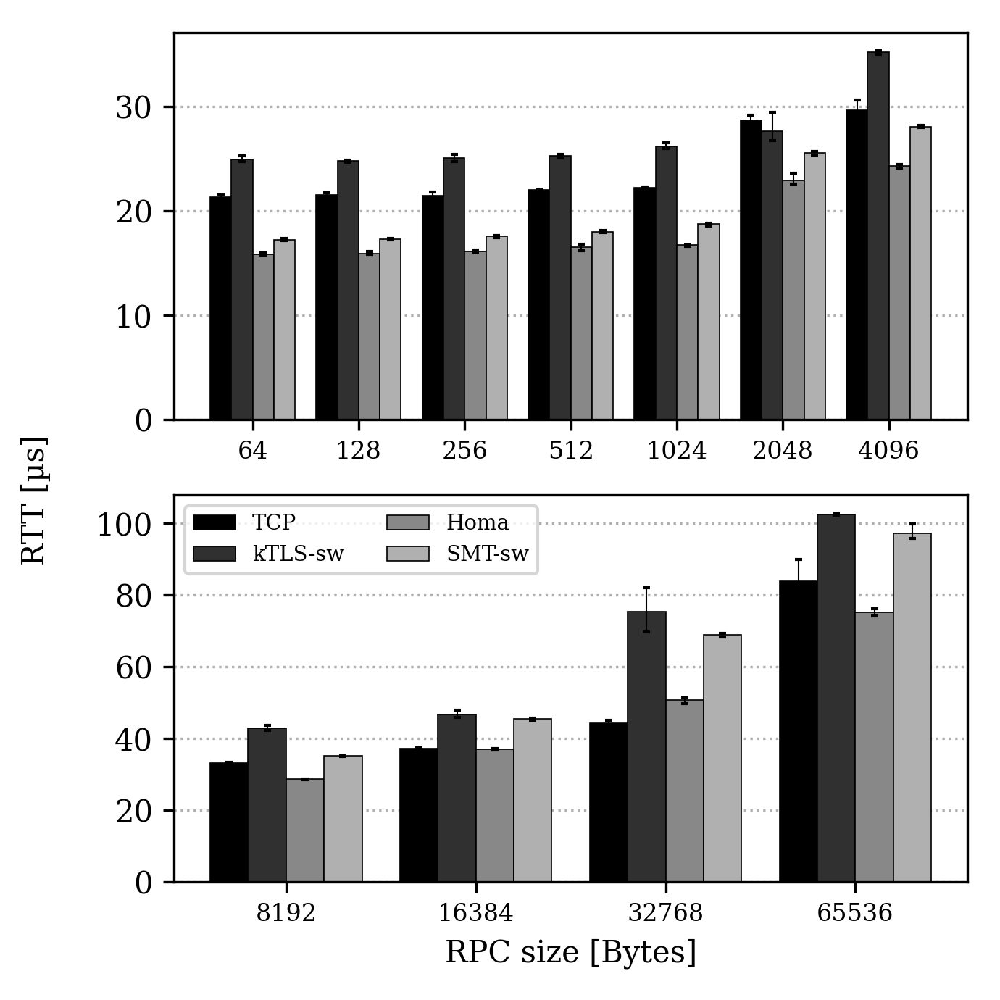
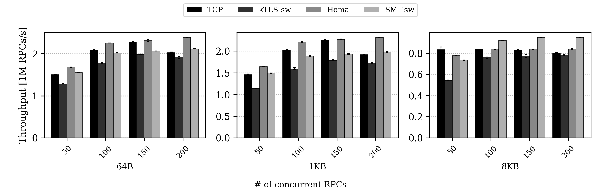
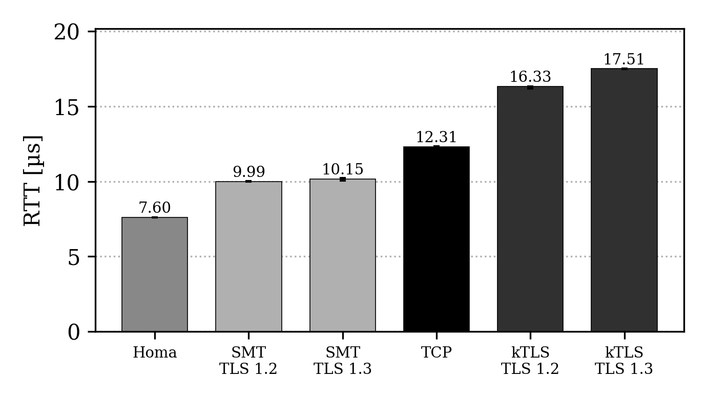

# SMT-NG: Secure Message Transport on Homa

> [!CAUTION]
> We rebase this branch onto upstream Homa `main` often and force-push it.
> Be prepared to get reset.



- SMT encrypts Homa messages as TLS records inside the transport.
- The sender seals each message as one or more TLS 1.2 or TLS 1.3 records,
  with AES-GCM-128 or AES-GCM-256. The receiver authenticates each record in
  the kernel.
- Applications keep the message API and the parallelism of Homa.
- Paper:
  [Designing Transport-Level Encryption for Datacenter Networks](https://github.com/uoenoplab/smt/blob/main/smt-oakland26.pdf)
  (IEEE S&P 2026). It describes the design and an evaluation of the first
  version.

This branch:

- Upstream Homa ([PlatformLab/HomaModule](https://github.com/PlatformLab/HomaModule)
  `main`, 07ce63ef of 2026-11-07), with SMT in the same module, `homa.ko`.
- Software crypto only: the `gcm(aes)` of the kernel.
- SMT-NG with NIC TLS offload is on the
  [`smt-ng-tls-offload`](https://github.com/uoenoplab/smt/tree/smt-ng-tls-offload)
  branch.
- The README of Homa is [README-homa.md](README-homa.md).

## Quick start

```
make                    # homa.ko with SMT
sudo insmod homa.ko
sudo sysctl net.homa.debug_only_smt_fixed_key=1   # allow the built-in key, for debugging only
make -C smt-apps/unloaded
# server
smt-apps/unloaded/simple_server --proto smt -p 2000 -l 1500
# client: 1000 echoes, every byte checked
smt-apps/unloaded/simple_client --proto smt -a <server> -p 2000 -l 1500 -n 1000 -c
```

- Tested on Linux 6.17.
- `make NO_CONFIG_SMT=1` builds plain Homa. So does `make __STRIP__=1`.
- SMT supports IPv4 only, with the DF bit set (`net.ipv4.ip_no_pmtu_disc` 0, the default). The receiver finds the place of a segment in its record from the IP id. The IP id counts the segments of a GSO packet from 0 only in DF packets.
- These programs have no handshake. They give their SMT sockets the
  built-in key, which all peers share and which protects nothing.
  [SMT APIs](smt-design.md#smt-apis) tells how an application gets its keys.

## Kernel interface and features

| interface | what it does |
|---|---|
| `setsockopt(fd, SOL_TLS, TLS_TX or TLS_RX, ...)` | installs or replaces the key of one direction for one peer ([SMT APIs](smt-design.md#smt-apis)) |
| `setsockopt(fd, SOL_TLS, SMT_KEY_DEL, ...)` | deletes the keys of one peer |
| `setsockopt(fd, SOL_TLS, SMT_DEBUG_FIXED_KEY, ...)` | debugging and benchmarks only: gives the socket the built-in key for all peers, with TLS 1.2 or 1.3 and AES-GCM-128 or -256 |
| sysctl `net.homa.smt_key_idle_secs` | deletes the keys of a peer after this many seconds without an RPC. 0 (default): never |
| sysctl `net.homa.debug_only_smt_fixed_key` | 1 allows `SMT_DEBUG_FIXED_KEY` on this host. 0 (default): it fails with EPERM |
| sysctl `net.homa.smt_record_segs` | the most segments in one record that the host sends. 0 (default): as many as fit in 16 KB of data and 20 segments |

- Records: TLS 1.2 or TLS 1.3, with AES-GCM-128 or AES-GCM-256. The key
  structs wrap those of kTLS.
- A record fills whole segments, and one TSO/GSO packet carries one or more
  whole records. The receiver authenticates each record independently
  ([On the wire](smt-design.md#on-the-wire)).
- The nonce of a record comes from its RPC id and its position in the
  message. The RPCs share no record counter, so they stay independent, as
  in Homa.
- Keys apply to one peer (IPv4 address and Homa port). A socket with keys
  refuses RPCs with a peer that has no keys. Only the built-in key of
  `SMT_DEBUG_FIXED_KEY` serves all peers, for debugging and benchmarks.
- An application can replace and delete keys. The RPCs that use a key
  when it is replaced or deleted finish with it.
- Replay guard: a server drops a request for an RPC that it authenticated
  before ([Security design](smt-design.md#security-design)).
- Crypto: software AES-GCM through the crypto API of the kernel
  (`gcm(aes)`).
- [Build switches](#build-switches) turn the performance features on or off.

## Layout

| path | contents |
|---|---|
| `homa_*` | upstream Homa, with the changes in [What SMT changes in Homa's files](#what-smt-changes-in-homas-files) |
| `smt_outgoing.c`, `smt_incoming.c` | the record layer: lay out and seal the records of a message, authenticate and decrypt them, replay guard |
| `smt_utils.c`, `smt_sw.c` | the keys of each peer, and the AES-GCM requests to the crypto API of the kernel |
| `smt_plumbing.c`, `smt_*.h` | the calls from Homa into SMT, and the shared definitions |
| `smt_uapi.h`, `smt_uapi.c` | the setsockopt interface. `smt_uapi.c` sets the fixed test keys for the apps |
| `smt-apps/` | the [user-space apps](#user-space-apps) |
| `test/smt/` | the unit tests of SMT: Homa built with `CONFIG_SMT`, the mocks of Homa's unit tests, and no AES-GCM. `make -C test/smt test` |
| `smt-apps/figures/` | the plots of the [evaluation](#evaluation), and the [animation of SMT on the wire](smt-design.md#on-the-wire) (`smt-wire.svg`, which `smt-wire.py` draws, and the interactive `smt-wire.html`) |
| `smt-design.md` | the key interface, the wire format and the security design of SMT |
| `README-homa.md` | the README of Homa |

## User-space apps

Run `make` in each directory of [smt-apps](smt-apps). The Go and Rust
programs need their toolchains. `make cert` in `handshake-c` makes `ca.pem`
and a certificate for each end. The handshake programs read these files
from the directory that they run in.

| program | language | protocols | SMT keys |
|---|---|---|---|
| `unloaded/simple_server`, `simple_client` | C | smt, homa, tcp, tcp_ktls | the built-in key only, no handshake |
| `unloaded-golang/simple_server`, `simple_client` | Go | smt, homa, tcp, tcp_ktls (with `GODEBUG=asyncpreemptoff=1`: a kTLS fault in Linux 6.17 breaks the connection when a signal interrupts a blocked send) | the built-in key, or `--handshake` with optional `--mtls` |
| `unloaded-rust/simple_server`, `simple_client` | Rust | smt, homa, tcp, tcp_ktls | the built-in key, or `--handshake` with optional `--mtls` |
| `handshake-c/smt_handshake` | C | smt | a handshake with an optional client certificate, then one echo |
| `loaded/loaded_server`, `loaded_client` | C | smt, homa, tcp, tcp_ktls | the built-in key |

- The three `unloaded` versions take the same options and print the same
  RESULT JSON. The CONFIG block of the Go and Rust versions also gives the
  kind of keys.
- They send one RPC at a time. `-l` gives the size of the messages, or
  `request,response`. `-n` gives the number of round trips. `-c` checks
  every echoed byte.
- Without `--handshake`, the programs give an SMT socket the built-in key
  (`SMT_DEBUG_FIXED_KEY`), and a kTLS socket fixed test keys. Both are TLS
  1.2 and AES-GCM-128. `SMT_TLS=13` and `SMT_KEY_BITS=256` in the
  environment change them.
- The built-in key needs `net.homa.debug_only_smt_fixed_key=1` on each
  host, or the SMT programs stop with an error.
- The programs pin themselves to core 1. With `HOMA_ECHO_PIN_CORE_DISABLE=1`
  they stay where `taskset` puts them. A client and a server on one host
  need this, because on one core the busy-polling client competes with the
  server.
- `--handshake` (Go and Rust, `--proto smt`): the keys come from a TLS 1.3
  handshake over Homa to port 4433 of the server, as in `handshake-c`. The
  records are TLS 1.3, with AES-GCM-128. With `--mtls` the client presents
  `client.pem`, and the server requires a client certificate. All handshake
  servers and clients here interoperate.

## Build switches

| switch | default | what it does | measured effect (duck, 100 Gb/s) |
|---|---|---|---|
| `CONFIG_SMT_TX_PIPELINE` | on | sends each record when it is sealed, not after the copy of the whole message | 64 KB, one RPC: RTT −21 % |
| `CONFIG_SMT_RX_ALIGN` | on | lays out received ciphertext so that AES-GCM steps from packet to packet on 16-byte boundaries | RX AES-GCM cycles −20–25 %. Throughput +0–3 % |
| `ENABLE_TIME_TRACE=0` | on | leaves out the timetrace records of Homa (about 380 ns for each RPC) | 1 KB: +2–10 % |
| `CONFIG_SMT_RX_ZC` | off | decrypts records of 4 KB or more directly into the buffers of the user | none: the pinning of pages costs as much as the copy |
| `CONFIG_SMT_NO_SEG_HDR` | off | leaves out the 4-byte `homa_seg_hdr` of each segment in a record, which changes the wire format | none |
| `CONFIG_SMT_NO_REPLAY_GUARD` | off | measurement only: no replay guard | none |
| `CONFIG_SMT_NOCRYPTO` | off | tests only: frames the records but does not encrypt them | |

The Makefile turns on the first three with `SMT_FEATURES`.
`make SMT_FEATURES=` builds without them.
`make SMT_CFLAGS=-DCONFIG_SMT_RX_ZC` adds a switch.
`make debug` adds the log messages of SMT.

## Evaluation

The tests ran on Linux 6.17.8, on two KVM guests (virtio) and on two hosts
that are connected back to back. Each host has a Xeon Silver 4314 (16 cores)
and a 100 Gb/s BlueField-3 NIC. Each echo below checks every byte.

| test | where | result |
|---|---|---|
| echo of 23 sizes from 1 B to 1 MB around segment, record and trailer boundaries, `max_gso_size` 10000 and 65000: TLS 1.2 and 1.3 × AES-GCM-128 and -256, plain Homa, the built-in key with TLS 1.2 and 1.3 | two hosts | 0 failures |
| the same with 1 % of Homa packets dropped at each receiver | two hosts | 0 failures |
| the same with `smt_record_segs` 0, 1 and 3 at `max_gso_size` 10000, 16000 and 65000: TLS 1.2 and 1.3, `CONFIG_SMT_NOCRYPTO`, 1 % of packets dropped. `smt_record_segs` 0 and 3 in the builds without `CONFIG_SMT_TX_PIPELINE` or `CONFIG_SMT_RX_ALIGN`, and with `CONFIG_SMT_NO_SEG_HDR` or `CONFIG_SMT_RX_ZC` | two hosts | 53 sweeps, 0 failures, no kernel messages |
| the same over loopback, `max_gso_size` 1000, 10000 and 65000 | one host, one guest | 0 failures |
| `unloaded` in C, Go and Rust, every server and client pair: Homa, SMT with the fixed keys (TLS 1.2 / AES-GCM-128 and TLS 1.3 / AES-GCM-256), TCP, kTLS. 64 B, 1 MB, 3000 B requests with 100000 B responses, and the reverse | two hosts | 180 / 180. Each client that SIGINT stops prints its result |
| handshake servers and clients (`handshake-c`, `--handshake` in Go and Rust), every pair, without and with mutual TLS. Then clients without a certificate against servers that require one | two hosts | 17 / 17 pairs pass. The servers refuse the 6 clients without a certificate |
| 300 clients in a row, one socket each, fixed and setsockopt keys | two hosts, loopback | 0 failures |
| loaded echo, 10 min each of 64 B × 200, 1 KB × 150, 8 KB × 100 and 64 KB × 50 RPCs in flight on one module load | two hosts | no RPC errors, no kernel warnings, no replay drops |
| loaded echo over loopback, 2 min each of 64 B, 1500 B and 64 KB × 64 RPCs | one host | no RPC errors, no retransmissions. p99 78–82 µs (64 KB: 366 µs) |
| `rmmod` after the tests | all | no SMT objects left |
| unit tests (`test/smt`): the setsockopt checks, replacing, deleting and reclaiming keys, the built-in key, record framing and layout, several records in one packet, nonces, the replay window | build host | 29 / 29, no leaks |
| keys: replace both or one, delete, reclaim after `smt_key_idle_secs`, refuse a peer without keys. 2000 peers on one socket, deleted or reclaimed. `handshake-c` with its bye | two guests | 0 failures, no kernel warnings |
| keys from a handshake or the built-in key only. `unloaded` in C, Go and Rust, every pair. Protocols: Homa with the built-in key allowed, SMT with the built-in key (TLS 1.2 / AES-GCM-128, TLS 1.3 / AES-GCM-256), TCP, kTLS. Every handshake pair. The setsockopt rules (`keyrules.py` in SMT-NG_benchs). Idle reclaim with the built-in key | two hosts | 180 / 180 echoes, 17 / 17 handshake pairs, 16 / 16 rules. Without `debug_only_smt_fixed_key=1` the programs stop with EPERM. No kernel warnings |
| builds: default, `SMT_FEATURES=`, `CONFIG_SMT_NOCRYPTO`, `CONFIG_SMT_RX_ZC` with `CONFIG_SMT_NO_SEG_HDR` and `CONFIG_SMT_NO_REPLAY_GUARD`, `NO_CONFIG_SMT=1` | guest | no compiler warnings. The echo tests pass |

The plots below come from two hosts at 100 Gb/s. kTLS and SMT both use
software AES-GCM-128 and TLS 1.2 records. Our mlx5 flex-parser patch steers
the RX of SMT (and of Homa) to four queues, as RSS does for TCP. The layout
is that of Figures 6 and 7 of the paper.

One RPC at a time, mean RTT:



Throughput with 50 to 200 RPCs in flight:



One host over loopback: 1500 B echo, one RPC at a time. The server and the
client run on cores of their own. The plot gives the median RTT of 3 × 100000
calls (3 × 1000 gives the same). Encryption adds 2.39 µs (TLS 1.2) and 2.55 µs (TLS 1.3) to the RTT
of Homa with SMT. It adds 4.02 µs and 5.20 µs to the RTT of TCP with kTLS.



### Record layout

A record fills whole segments, with at most 16 KB of data (11 segments at
MTU 1500). A GSO packet carries as many whole records as fit. The table
gives the throughput at `max_gso_size` 65000, relative to one record in
each GSO packet (smt-ng-split 92c3f11d). 12 threads, 10 s cells, means of
3 rounds (round-to-round spread at most 5.0 %).

| layout | 8 KB × 1 / 50 / 150 RPCs | 64 KB × 1 / 50 / 150 | 256 KB × 1 / 50 / 150 |
|---|---|---|---|
| several records in each GSO packet (this version) | 1.01 / 1.01 / 1.02 | 1.00 / 1.00 / 0.99 | 1.01 / 1.15 / 1.14 |
| one record in each segment (`smt_record_segs` 1) | 0.89 / 0.69 / 0.53 | 0.60 / 0.47 / 0.51 | 0.42 / 1.10 / 1.09 |
| plain Homa, for comparison | 1.19 / 1.14 / 1.05 | 1.26 / 1.02 / 1.13 | 1.48 / 1.11 / 1.13 |

- At 256 KB under load, SMT is level with plain Homa. The size of the GSO
  packets limits it there, not the encryption.
- One record in each segment costs one AES-GCM operation for each packet
  and 29 bytes of each segment (TLS 1.2).

## What SMT changes in Homa's files

| file | change |
|---|---|
| `homa_sock.c`, `homa_sock.h` | the SMT state of each socket, set up and released with the socket |
| `homa_rpc.c`, `homa_rpc.h` | each RPC finds the keys of its peer and holds them until it is reaped. A single-packet request goes to the user only when its whole record is there |
| `homa_outgoing.c` | lays out and seals messages as records, whole records in each packet |
| `homa_incoming.c` | queues packets by record, and decrypts each record on its way to the user (`homa_copy_to_user`) |
| `homa_offload.c` | GRO bypass for single-packet SMT messages |
| `homa_qdisc.c`, `homa_impl.h` | deferred packets take their offset from `homa_skb_info`, because the linear part of an SMT packet ends before `homa_seg_hdr` |
| `homa_plumbing.c` | the `SOL_TLS` setsockopt, the sysctls `smt_sw_pool_init`, `smt_key_idle_secs`, `debug_only_smt_fixed_key` and `smt_record_segs`, load and unload. No TCP hijacking |
| `homa_timer.c` | deletes the keys that no RPC used for `smt_key_idle_secs`, about once a second |
| `homa_metrics.c`, `homa_metrics.h` | `smt_replay_drops`, `smt_replay_too_old` |
| `timetrace.h` | `ENABLE_TIME_TRACE` can come from the build |

## Design

[smt-design.md](smt-design.md) describes the key interface (SMT APIs), the wire format and the security design.
