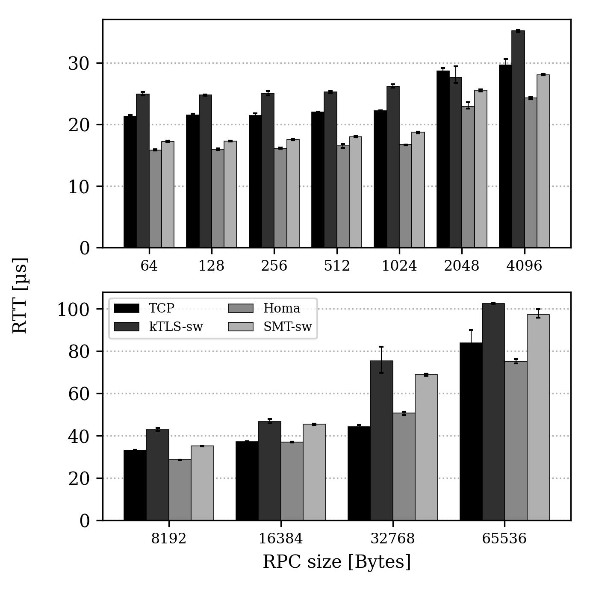
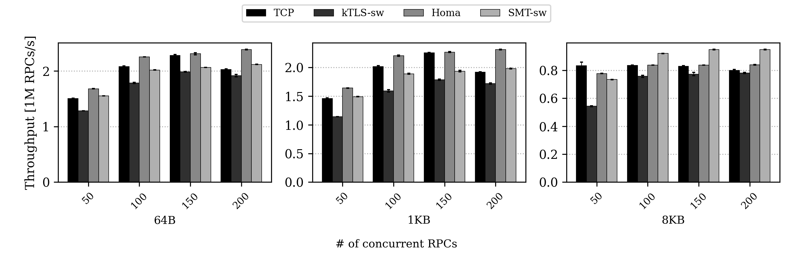
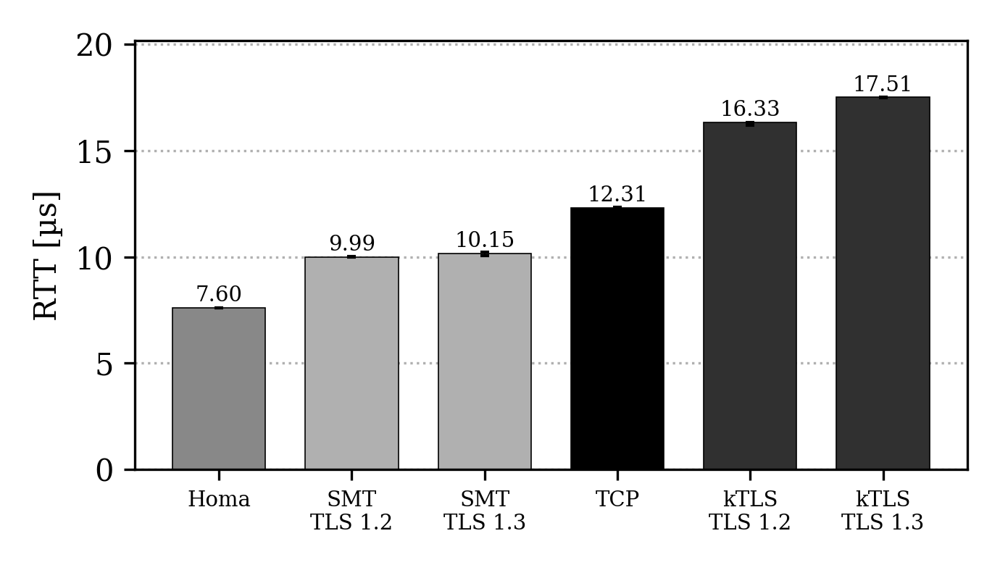

# SMT-NG: Secure Message Transport on Homa

SMT encrypts Homa messages as TLS records inside the transport: every Homa
message is sent as one or more TLS 1.2 or TLS 1.3 records (AES-GCM-128 or
-256), sealed by the sender and authenticated by the receiver in the kernel,
so applications keep Homa's message API and its parallelism. The design and
an evaluation of the first version are in our S&P'26 paper, "Designing
Transport-Level Encryption for Datacenter Networks".

This tree is upstream Homa ([PlatformLab/HomaModule](https://github.com/PlatformLab/HomaModule)
`main`, ae45ada5 of 2026-10-20) with SMT built into the same module,
`homa.ko`. Crypto is software only (the kernel's `gcm(aes)`); SMT's NIC
offload is not part of this tree. Homa's own README is
[README-homa.md](README-homa.md).

## Build and load

```
make                     # homa.ko with SMT
sudo insmod homa.ko
```

Tested on Linux 6.17. `make NO_CONFIG_SMT=1` builds plain Homa. SMT is
IPv4 only.

## Keys

A socket encrypts traffic with a peer once it has keys for that peer (or a
default key for all peers); traffic without keys is plain Homa. Both ends
must use the same keys, TLS version and build switches.

1. **No handshake (debugging / benchmarking only)**:
   `sudo sysctl net.homa.smt_fixed_key=12` gives every Homa socket created
   afterwards a built-in AES-GCM-128 key for all peers, with TLS 1.2 records
   (`13`: TLS 1.3 records). Applications need no change. The key is in the
   source, so this protects nothing; set the same value on every host. `0`
   (the default) turns it off for sockets created afterwards.
2. **setsockopt**, as for kTLS:
   `setsockopt(fd, SOL_TLS, TLS_TX or TLS_RX, &info, sizeof(info))` with
   `struct smt_aes_gcm_128_info` or `smt_aes_gcm_256_info` from
   [smt_uapi.h](smt_uapi.h): the peer's IPv4 address and Homa port (network
   order; both 0 for a key that serves every peer without its own), then the
   kernel's `tls12_crypto_info_aes_gcm_128/256` with `TLS_1_2_VERSION` or
   `TLS_1_3_VERSION`. Set both directions for a peer; a direction's key
   can't be replaced. For TLS 1.2, `iv` must equal `rec_seq`.
3. **Handshake example**, [smt-apps/handshake](smt-apps/handshake), in C with
   OpenSSL (`smt_handshake`) and in Go with crypto/tls (`go/`,
   `make go` builds `smt_handshake_go`): a TLS 1.3 handshake over TCP, the
   keys derived with the TLS exporter (RFC 8446 §7.5) and installed with
   setsockopt for that peer only. The two programs interoperate, so any TLS
   library with the exporter can do the handshake without access to TLS
   internals: Go's `ConnectionState.ExportKeyingMaterial`, rustls's
   `export_keying_material`, OpenSSL's `SSL_export_keying_material`. The
   handshake needs its own stream connection, since Homa carries messages.

## Records and security

- A record is one GSO packet: at most `max_gso_size` bytes, 20 segments and
  16 KB of data. The receiver authenticates each record as a whole.
- Record sequence numbers, from which nonces are made: record *i* of a
  message gets (RPC id ≫ 1) ≪ 17 | response bit ≪ 16 | *i*. Nonces are thus
  unique under a key as long as the key is used with one peer and that peer's
  RPC ids don't repeat (the fixed key of `smt_fixed_key` is shared by all
  peers: debugging / benchmarking only).
- Replay guard: a server drops a request whose RPC it has already
  authenticated, keeping a window of the last 65536 RPCs per peer.

## Build switches

| switch | default | what it does | measured effect (duck, 100 Gb/s) |
|---|---|---|---|
| `CONFIG_SMT_TX_PIPELINE` | on | send each record as soon as it is sealed, instead of after the whole message is copied in | 64 KB, one RPC: RTT −19 %; 64 KB under load: throughput −6–8 % |
| `CONFIG_SMT_RX_ALIGN` | on | lay out received ciphertext so AES-GCM steps from packet to packet on 16-byte boundaries | RX AES-GCM cycles −20–25 %; throughput +0–3 % |
| `ENABLE_TIME_TRACE=0` | on | leave out Homa's timetrace records (~380 ns per RPC) | 1 KB: +2–10 % |
| `CONFIG_SMT_RX_ZC` | off | decrypt records of 4 KB or more straight into the user's buffers | none (pinning pages costs what the copy did) |
| `CONFIG_SMT_NO_SEG_HDR` | off | records leave out each segment's 4-byte `homa_seg_hdr`; changes the wire format | none |
| `CONFIG_SMT_NO_REPLAY_GUARD` | off | measurement only: no replay guard | none |
| `CONFIG_SMT_NOCRYPTO` | off | testing: records framed but not encrypted | |

The first three are `SMT_FEATURES` in the Makefile: `make SMT_FEATURES=`
builds without them, `make SMT_CFLAGS=-DCONFIG_SMT_RX_ZC` adds others,
`make debug` adds SMT's log messages.

## Test programs

[smt-apps](smt-apps): `make` in each directory.

- `unloaded/simple_server`, `simple_client`: one RPC at a time,
  `--proto smt|homa|tcp|tcp_ktls`, `-l` bytes, `-c` checks every echoed
  byte. With `--proto smt` (or `tcp_ktls`) they install fixed test keys with
  setsockopt (TLS 1.2 and AES-GCM-128; `SMT_TLS=13`, `SMT_KEY_BITS=256` in
  the environment change that), unless `net.homa.smt_fixed_key` is set.
  Both pin themselves to core 1; with `HOMA_ECHO_PIN_CORE_DISABLE=1` they
  stay where `taskset` puts them, which client and server on one host need
  (on one core, the client's busy-polling competes with the server).
- `loaded/loaded_server`, `loaded_client`: many threads, sockets and RPCs in
  flight.
- `handshake/smt_handshake`, `smt_handshake_go`: see Keys; `make cert`
  makes the server's certificate.
- `util/config_unloaded`, `config_loaded`: the host setup we measure with
  (NIC coalescing, IRQ affinity, RPS, Homa sysctls).

## Tests

Linux 6.17.8 on two KVM guests (virtio) and on two hosts with Xeon Silver
4314 (16 cores) and 100 Gb/s BlueField-3 NICs back to back. Every echo below
checks every byte.

| test | where | result |
|---|---|---|
| echo of 23 sizes from 1 B to 1 MB around segment, record and trailer boundaries, `max_gso_size` 10000 and 65000: TLS 1.2 and 1.3 × AES-GCM-128 and -256, plain Homa, `smt_fixed_key` 12 and 13 | two hosts | 0 failures |
| the same with 1 % of Homa packets dropped at each receiver | two hosts | 0 failures |
| the same over loopback, `max_gso_size` 1000, 10000 and 65000 | one host, one guest | 0 failures |
| handshake examples, C and Go servers with C and Go clients, TLS 1.2 and 1.3 records, 64 B to 1 MB | two hosts, two guests, loopback | 0 failures |
| 300 clients in a row, a socket each, fixed and setsockopt keys | two hosts, loopback | 0 failures |
| loaded echo, 10 min each of 64 B × 200, 1 KB × 150, 8 KB × 100 and 64 KB × 50 RPCs in flight on one module load | two hosts | no RPC errors, no kernel warnings, no replay drops |
| loaded echo over loopback, 2 min each of 64 B, 1500 B and 64 KB × 64 RPCs | one host | no RPC errors, no retransmissions; p99 78–82 µs (64 KB: 366 µs) |
| `rmmod` after the tests | all | no SMT objects left |
| builds: default, `SMT_FEATURES=`, `CONFIG_SMT_NOCRYPTO`, `CONFIG_SMT_RX_ZC` with `CONFIG_SMT_NO_SEG_HDR` and `CONFIG_SMT_NO_REPLAY_GUARD`, `NO_CONFIG_SMT=1` | guest | no compiler warnings; echo tests pass |

Two hosts, 100 Gb/s, software AES-GCM-128 and TLS 1.2 records for both
kTLS and SMT, SMT's (and Homa's) RX steered to four queues as TCP's RSS is
(with our mlx5 flex-parser patch), laid out as Figures 6 and 7 of the paper.

One RPC at a time, mean RTT:



Throughput with 50 to 200 RPCs in flight:



One host over loopback, 1500 B echo, one RPC at a time, server and client on
cores of their own, median RTT of 3 × 100000 calls (3 × 1000 gives the
same). Encryption adds 2.39 µs (TLS 1.2) and 2.55 µs (TLS 1.3) to Homa's
RTT with SMT, 4.02 µs and 5.20 µs to TCP's with kTLS:



## What SMT changes in Homa's files

| file | change |
|---|---|
| `homa_sock.c`, `homa_sock.h` | per-socket SMT state, set up and torn down with the socket |
| `homa_rpc.c`, `homa_rpc.h` | each RPC finds its peer's keys; a single-packet request is handed off only once its whole record is there |
| `homa_outgoing.c` | messages laid out and sealed as records; one record per packet |
| `homa_incoming.c` | packets queued by record; each record decrypted on its way to the user (`homa_copy_to_user`) |
| `homa_offload.c` | GRO bypass for single-packet SMT messages |
| `homa_qdisc.c`, `homa_impl.h` | deferred packets take their offset from `homa_skb_info`, since an SMT packet carries its record header where `homa_seg_hdr` was |
| `homa_plumbing.c` | `SOL_TLS` setsockopt, sysctls `smt_fixed_key` and `smt_sw_pool_init`, load and unload; TCP hijacking left out |
| `homa_metrics.c`, `homa_metrics.h` | `smt_replay_drops`, `smt_replay_too_old` |
| `timetrace.h` | `ENABLE_TIME_TRACE` can come from the build |
