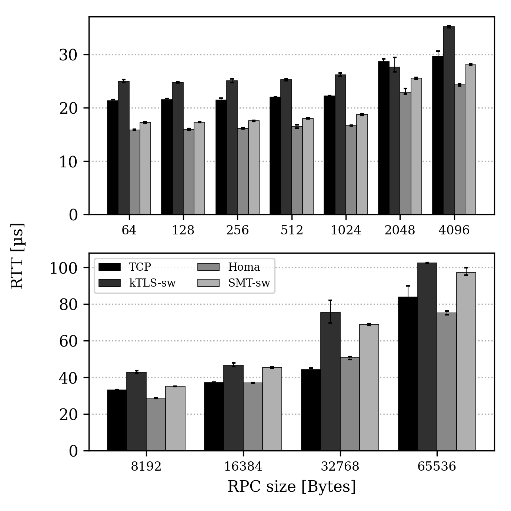
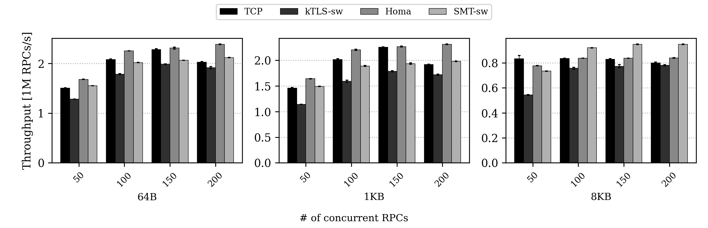
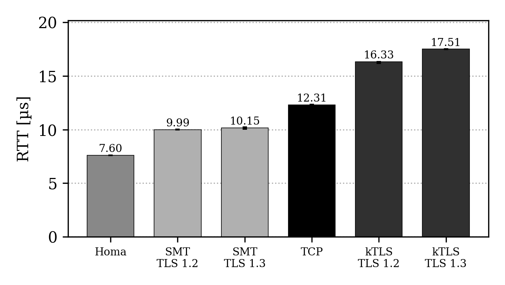

# SMT-NG: Secure Message Transport on Homa

> [!CAUTION]
> We rebase this branch onto upstream Homa `main` often and force-push it.
> Be prepared to get reset.



- SMT encrypts Homa messages as TLS records inside the transport.
- The sender seals each message as one or more TLS 1.2 or TLS 1.3 records,
  with AES-GCM-128 or AES-GCM-256. The receiver authenticates each record in
  the kernel.
- Applications keep the message API and the parallelism of Homa.
- Paper:
  [Designing Transport-Level Encryption for Datacenter Networks](https://github.com/uoenoplab/smt/blob/main/smt-oakland26.pdf)
  (IEEE S&P 2026). It describes the design and an evaluation of the first
  version.

This branch:

- Upstream Homa ([PlatformLab/HomaModule](https://github.com/PlatformLab/HomaModule)
  `main`, 5cb0ec2c of 2026-11-06), with SMT in the same module, `homa.ko`.
- Software crypto only: the `gcm(aes)` of the kernel.
- SMT-NG with NIC TLS offload is on the
  [`smt-ng-tls-offload`](https://github.com/uoenoplab/smt/tree/smt-ng-tls-offload)
  branch.
- The README of Homa is [README-homa.md](README-homa.md).

## Quick start

```
make                                  # homa.ko with SMT
sudo insmod homa.ko
make -C smt-apps/unloaded
# server
smt-apps/unloaded/simple_server --proto smt -p 2000 -l 1500
# client: 1000 echoes, every byte checked
smt-apps/unloaded/simple_client --proto smt -a <server> -p 2000 -l 1500 -n 1000 -c
```

- Tested on Linux 6.17.
- `make NO_CONFIG_SMT=1` builds plain Homa.
- SMT supports IPv4 only.
- These programs use fixed test keys. [Keys](#keys) tells how an
  application gets its keys.

## Layout

| path | contents |
|---|---|
| `homa_*` | upstream Homa, with the changes in [What SMT changes in Homa's files](#what-smt-changes-in-homas-files) |
| `smt_outgoing.c`, `smt_incoming.c` | the record layer: lay out and seal the records of a message, authenticate and decrypt them, replay guard |
| `smt_utils.c`, `smt_sw.c` | the keys of each peer, and the AES-GCM requests to the crypto API of the kernel |
| `smt_plumbing.c`, `smt_*.h` | the calls from Homa into SMT, and the shared definitions |
| `smt_uapi.h`, `smt_uapi.c` | the setsockopt interface. `smt_uapi.c` sets the fixed test keys for the apps |
| `smt-apps/` | the [user-space apps](#user-space-apps) |
| `figures/` | the plots of the [evaluation](#evaluation), and the [animation of SMT on the wire](#on-the-wire) (`smt-wire.svg`, which `smt-wire.py` draws, and the interactive `smt-wire.html`) |
| `README-homa.md` | the README of Homa |

## Kernel interface and features

| interface | what it does |
|---|---|
| `socket(AF_INET, SOCK_DGRAM, IPPROTO_HOMA)`, `sendmsg`, `recvmsg` | the message API of Homa, without change |
| `setsockopt(fd, SOL_TLS, TLS_TX or TLS_RX, ...)` | installs the key of one direction, for one peer or for all peers ([Keys](#keys)) |
| sysctl `net.homa.smt_fixed_key` | 12 or 13: new sockets get a built-in key for all peers, for debugging and benchmarks. 0 (default): no key |
| sysctl `net.homa.smt_sw_pool_init` | the number of AES-GCM requests that SMT allocates in advance for each key and direction (default 4) |
| `/proc/net/homa_metrics` | adds `smt_replay_drops` and `smt_replay_too_old` |

- Records: TLS 1.2 or TLS 1.3, with AES-GCM-128 or AES-GCM-256. The key
  structs wrap those of kTLS.
- One record is one TSO/GSO packet. The receiver authenticates each record
  independently ([On the wire](#on-the-wire)).
- The nonce of a record comes from its RPC id and its position in the
  message. The RPCs share no record counter, so they stay independent, as
  in Homa.
- Keys apply to one peer (IPv4 address and Homa port), or to all peers.
- Replay guard: a server drops a request for an RPC that it authenticated
  before ([Security design](#security-design)).
- Crypto: software AES-GCM through the crypto API of the kernel
  (`gcm(aes)`).
- [Build switches](#build-switches) turn the performance features on or off.

## User-space apps

Run `make` in each directory of [smt-apps](smt-apps). The Go and Rust
programs need their toolchains. `make cert` in `handshake-c` makes `ca.pem`
and a certificate for each end. The handshake programs read these files
from the directory that they run in.

| program | language | protocols | SMT keys |
|---|---|---|---|
| `unloaded/simple_server`, `simple_client` | C | smt, homa, tcp, tcp_ktls | fixed test keys only, no handshake |
| `unloaded-golang/simple_server`, `simple_client` | Go | smt, homa, tcp, tcp_ktls (with `GODEBUG=asyncpreemptoff=1`: a kTLS fault in Linux 6.17 breaks the connection when a signal interrupts a blocked send) | fixed test keys, or `--handshake` with optional `--mtls` |
| `unloaded-rust/simple_server`, `simple_client` | Rust | smt, homa, tcp, tcp_ktls | fixed test keys, or `--handshake` with optional `--mtls` |
| `handshake-c/smt_handshake` | C | smt | a handshake with an optional client certificate, then one echo |
| `loaded/loaded_server`, `loaded_client` | C | smt, homa, tcp, tcp_ktls | fixed test keys |
| `util/config_unloaded`, `config_loaded` | shell | | the host setup for our measurements: NIC coalescing, IRQ affinity, RPS, Homa sysctls |

- The three `unloaded` versions take the same options and print the same
  RESULT JSON. The CONFIG block of the Go and Rust versions also gives the
  kind of keys.
- They send one RPC at a time. `-l` gives the size of the messages, or
  `request,response`. `-n` gives the number of round trips. `-c` checks
  every echoed byte.
- The fixed keys are TLS 1.2 and AES-GCM-128. `SMT_TLS=13` and
  `SMT_KEY_BITS=256` in the environment change them. If
  `net.homa.smt_fixed_key` is set, the programs set no keys.
- The programs pin themselves to core 1. With `HOMA_ECHO_PIN_CORE_DISABLE=1`
  they stay where `taskset` puts them. A client and a server on one host
  need this, because on one core the busy-polling client competes with the
  server.
- `--handshake` (Go and Rust, `--proto smt`): the keys come from a TLS 1.3
  handshake over Homa to port 4433 of the server, as in `handshake-c`. The
  records are TLS 1.3, with AES-GCM-128. With `--mtls` the client presents
  `client.pem`, and the server requires a client certificate. All handshake
  servers and clients here interoperate.

## Build switches

| switch | default | what it does | measured effect (duck, 100 Gb/s) |
|---|---|---|---|
| `CONFIG_SMT_TX_PIPELINE` | on | sends each record when it is sealed, not after the copy of the whole message | 64 KB, one RPC: RTT −19 %. 64 KB under load: throughput −6–8 % |
| `CONFIG_SMT_RX_ALIGN` | on | lays out received ciphertext so that AES-GCM steps from packet to packet on 16-byte boundaries | RX AES-GCM cycles −20–25 %. Throughput +0–3 % |
| `ENABLE_TIME_TRACE=0` | on | leaves out the timetrace records of Homa (about 380 ns for each RPC) | 1 KB: +2–10 % |
| `CONFIG_SMT_RX_ZC` | off | decrypts records of 4 KB or more directly into the buffers of the user | none: the pinning of pages costs as much as the copy |
| `CONFIG_SMT_NO_SEG_HDR` | off | leaves out the 4-byte `homa_seg_hdr` of each segment in a record, which changes the wire format | none |
| `CONFIG_SMT_NO_REPLAY_GUARD` | off | measurement only: no replay guard | none |
| `CONFIG_SMT_NOCRYPTO` | off | tests only: frames the records but does not encrypt them | |

The Makefile turns on the first three with `SMT_FEATURES`.
`make SMT_FEATURES=` builds without them.
`make SMT_CFLAGS=-DCONFIG_SMT_RX_ZC` adds a switch.
`make debug` adds the log messages of SMT.

## Evaluation

The tests ran on Linux 6.17.8, on two KVM guests (virtio) and on two hosts
that are connected back to back. Each host has a Xeon Silver 4314 (16 cores)
and a 100 Gb/s BlueField-3 NIC. Each echo below checks every byte.

| test | where | result |
|---|---|---|
| echo of 23 sizes from 1 B to 1 MB around segment, record and trailer boundaries, `max_gso_size` 10000 and 65000: TLS 1.2 and 1.3 × AES-GCM-128 and -256, plain Homa, `smt_fixed_key` 12 and 13 | two hosts | 0 failures |
| the same with 1 % of Homa packets dropped at each receiver | two hosts | 0 failures |
| the same over loopback, `max_gso_size` 1000, 10000 and 65000 | one host, one guest | 0 failures |
| `unloaded` in C, Go and Rust, every server and client pair: Homa, SMT with the fixed keys (TLS 1.2 / AES-GCM-128 and TLS 1.3 / AES-GCM-256), TCP, kTLS. 64 B, 1 MB, 3000 B requests with 100000 B responses, and the reverse | two hosts | 180 / 180. Each client that SIGINT stops prints its result |
| handshake servers and clients (`handshake-c`, `--handshake` in Go and Rust), every pair, without and with mutual TLS. Then clients without a certificate against servers that require one | two hosts | 17 / 17 pairs pass. The servers refuse the 6 clients without a certificate |
| 300 clients in a row, one socket each, fixed and setsockopt keys | two hosts, loopback | 0 failures |
| loaded echo, 10 min each of 64 B × 200, 1 KB × 150, 8 KB × 100 and 64 KB × 50 RPCs in flight on one module load | two hosts | no RPC errors, no kernel warnings, no replay drops |
| loaded echo over loopback, 2 min each of 64 B, 1500 B and 64 KB × 64 RPCs | one host | no RPC errors, no retransmissions. p99 78–82 µs (64 KB: 366 µs) |
| `rmmod` after the tests | all | no SMT objects left |
| builds: default, `SMT_FEATURES=`, `CONFIG_SMT_NOCRYPTO`, `CONFIG_SMT_RX_ZC` with `CONFIG_SMT_NO_SEG_HDR` and `CONFIG_SMT_NO_REPLAY_GUARD`, `NO_CONFIG_SMT=1` | guest | no compiler warnings. The echo tests pass |

The plots below come from two hosts at 100 Gb/s. kTLS and SMT both use
software AES-GCM-128 and TLS 1.2 records. Our mlx5 flex-parser patch steers
the RX of SMT (and of Homa) to four queues, as RSS does for TCP. The layout
is that of Figures 6 and 7 of the paper.

One RPC at a time, mean RTT:



Throughput with 50 to 200 RPCs in flight:



One host over loopback: 1500 B echo, one RPC at a time. The server and the
client run on cores of their own. The plot gives the median RTT of 3 × 100000
calls (3 × 1000 gives the same). Encryption adds 2.39 µs (TLS 1.2) and 2.55 µs (TLS 1.3) to the RTT
of Homa with SMT. It adds 4.02 µs and 5.20 µs to the RTT of TCP with kTLS.



## What SMT changes in Homa's files

| file | change |
|---|---|
| `homa_sock.c`, `homa_sock.h` | the SMT state of each socket, set up and released with the socket |
| `homa_rpc.c`, `homa_rpc.h` | each RPC finds the keys of its peer. A single-packet request goes to the user only when its whole record is there |
| `homa_outgoing.c` | lays out and seals messages as records, one record in each packet |
| `homa_incoming.c` | queues packets by record, and decrypts each record on its way to the user (`homa_copy_to_user`) |
| `homa_offload.c` | GRO bypass for single-packet SMT messages |
| `homa_qdisc.c`, `homa_impl.h` | deferred packets take their offset from `homa_skb_info`, because an SMT packet has its record header where `homa_seg_hdr` was |
| `homa_plumbing.c` | the `SOL_TLS` setsockopt, the sysctls `smt_fixed_key` and `smt_sw_pool_init`, load and unload. No TCP hijacking |
| `homa_metrics.c`, `homa_metrics.h` | `smt_replay_drops`, `smt_replay_too_old` |
| `timetrace.h` | `ENABLE_TIME_TRACE` can come from the build |

## Design

### Keys

A socket encrypts the traffic with a peer when it has keys for that peer,
or a default key for all peers. Traffic without keys is plain Homa. The two
ends must use the same keys, the same TLS version and the same build
switches. An application can get keys in three ways:

1. **No handshake (debugging and benchmarks only)**:
   `sudo sysctl net.homa.smt_fixed_key=12` gives each Homa socket created
   after it a built-in AES-GCM-128 key for all peers, with TLS 1.2 records.
   `13` selects TLS 1.3 records. The applications need no change. The key is
   in the source, so it protects nothing. Set the same value on each host.
   `0` (the default) stops it for the sockets created after it.
2. **setsockopt**, as for kTLS:
   `setsockopt(fd, SOL_TLS, TLS_TX or TLS_RX, &info, sizeof(info))`, with
   `struct smt_aes_gcm_128_info` or `smt_aes_gcm_256_info` from
   [smt_uapi.h](smt_uapi.h). This struct holds the IPv4 address and the Homa
   port of the peer (network order). For a default key, both are 0. Then
   comes the `tls12_crypto_info_aes_gcm_128` or `_256` of the kernel, with
   `TLS_1_2_VERSION` or `TLS_1_3_VERSION`. Set both directions for a peer.
   A key for a direction cannot be replaced. For TLS 1.2, `iv` must be
   equal to `rec_seq`.
3. **Handshake**: a minimal proof of concept in
   [smt-apps/handshake-c](smt-apps/handshake-c) (C, OpenSSL), and the
   `--handshake` option of the Go (crypto/tls) and Rust (rustls) `unloaded`
   programs. Homa RPCs to a server port without keys carry a TLS 1.3
   handshake. There are two RPCs. The first carries the ClientHello. The
   second carries the last flight of the client and its Homa port as TLS
   application data. The client checks the certificate of the server. The
   server checks the certificate of the client if the client presents one,
   or if the server requires one. The two ends derive the keys with the TLS
   exporter (RFC 8446 §7.5, label `EXPORTER-SMT-NG keys`). Each end installs
   them with setsockopt for that peer only. Any TLS library with the
   exporter can do this: `SSL_export_keying_material` (OpenSSL),
   `ConnectionState.ExportKeyingMaterial` (Go), `export_keying_material`
   (rustls).

### On the wire

The animation at the top shows these steps. `uv run figures/smt-wire.py`
draws it with real AES-GCM bytes. For an interactive version of steps 2 to
9, open [figures/smt-wire.html](figures/smt-wire.html) in a browser. You can
change the RPC id, the record, the direction and the TLS version, or change
a packet on the wire.

- SMT changes only the DATA packets of Homa. The control packets (GRANT,
  RESEND, ACK and others) stay plain Homa.
- SMT cuts each message into records. A record holds up to `max_gso_data`
  message bytes. One record is one TSO/GSO packet: at most `max_gso_size`
  bytes, 20 segments and 16 KB of data.
- A record is a TLS record: the TLS header (`17 03 03`, length), the
  explicit nonce (TLS 1.2 only), the encrypted segments, the content type
  (TLS 1.3 only, encrypted) and the 16-byte tag. Each segment keeps its
  4-byte `homa_seg_hdr` inside the ciphertext.
- Record *i* of a message has the sequence number
  (RPC id ≫ 1) ≪ 17 | response bit ≪ 16 | *i*. The record index *i* has
  16 bits: a message has fewer than 2^16 records. The nonce is
  salt ‖ (iv XOR sequence number). The AAD is the TLS header (TLS 1.2: the
  sequence number, then the header).
- TSO/GSO cuts the record into packets and copies the Homa header into each
  packet. The IP id counts the packets of the record. The `pad` and
  `sequence` fields of the Homa header hold the offset of the record in the
  message.
- The receiver puts the segments of a record together by offset and IP id.
  Then it authenticates and decrypts the whole record. If a record fails
  authentication, its RPC fails, and recvmsg returns EBADMSG.
- A retransmitted record is the same byte for byte, because its header and
  its nonce come from the record index.

### Security design

- AES-GCM seals each record. This gives confidentiality and integrity to the
  message data. The control packets of Homa (GRANT, RESEND, ACK and others)
  are not encrypted and not authenticated. They carry no application data.
- The nonces under a key are unique if the key serves one peer and the RPC
  ids of that peer do not repeat. All peers share the fixed key of
  `smt_fixed_key`, so that key is for debugging and benchmarks only.
- Replay guard: a server drops a request for an RPC that it authenticated
  before. It keeps a window of the last 65536 RPCs of each peer.
- A socket finds the keys of a peer by the IPv4 address and the Homa port of
  the peer. If the socket has no keys for a peer and no default key, it
  talks plain Homa with that peer. The application cannot see the
  difference. If the socket has a default key, each peer without its own
  key must use the default key. Then plain Homa requests get no answer.
- The handshake servers install the keys for the address that the RPCs come
  from and for the port that the client gives. A client that the server
  accepts can give any port on its host.
- A key stays until the socket closes. A key cannot be replaced or removed,
  so there is no rekeying yet.
